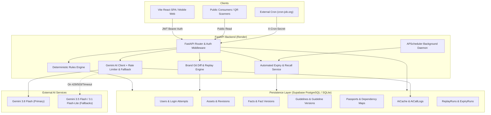
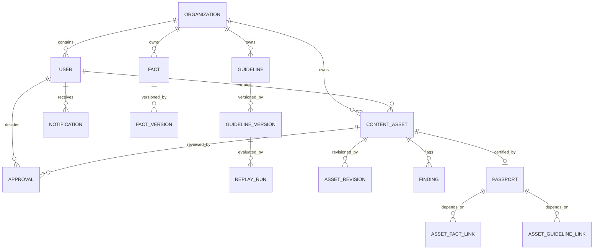
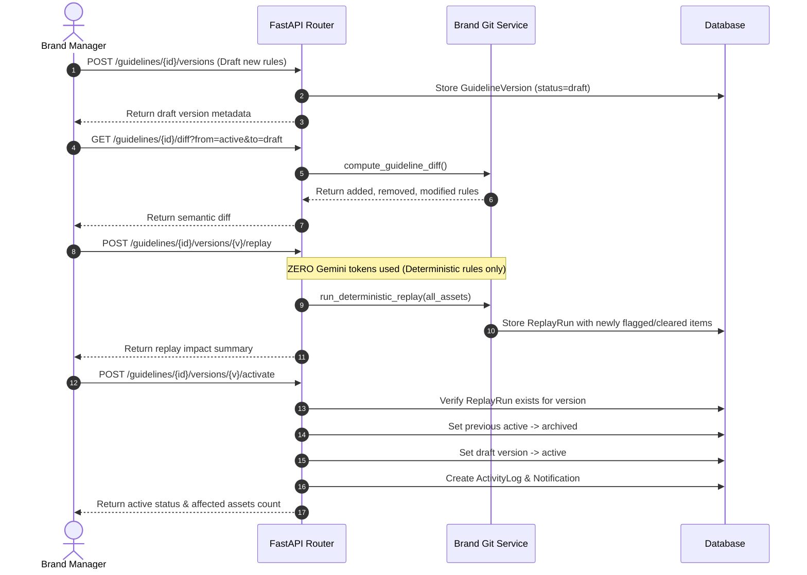
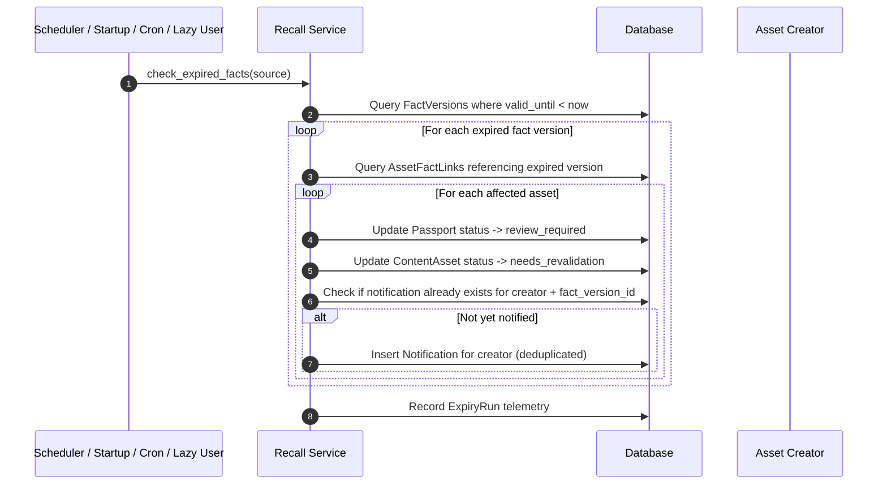

# BrandPilot Architecture & System Design

This document details the architecture, data models, workflows, and infrastructure design for BrandPilot.

---

## 1. High-Level System Architecture

---

## 2. Data Models & Entity Relationships

### Key Tables
1. **`organizations`**: Multi-tenant boundaries. All asset, fact, guideline, and activity records belong to an organization.
2. **`users`**: Team members with assigned roles (`brand_manager`, `creator`, `reviewer`), PBKDF2 password hashes, and cryptographic salts.
3. **`guideline_versions`**: Immutable version history for rules (banned terms, required phrases, claims). Tracks `status` (`draft`, `active`, `archived`, `rejected`), `change_note`, and creator.
4. **`facts` & `fact_versions`**: Source-of-truth claim values with effective date ranges (`valid_from`, `valid_until`) and active flags.
5. **`passports`**: Cryptographic certificates of compliance with unique public codes, status (`valid`, `review_required`, `withdrawn`), approval snapshots, and withdrawal audit trails.
6. **`asset_fact_links` & `asset_guideline_links`**: The dependency graph capturing the exact fact versions and guideline versions frozen at time of approval.
7. **`replay_runs`**: Persisted outcomes of deterministic rule replays against asset corpora.
8. **`expiry_runs`**: Historical logs of claim expiration sweeps.
9. **`ai_cache` & `ai_call_logs`**: Permanent database cache of AI outputs and hourly rate limit tracking.

---

## 3. Brand Git Workflow (Replay & Activation)

---

## 4. Automated Expiry & Post-Publication Recall

---

## 5. AI Safety & Quota Architecture

BrandPilot employs a multi-tier defense system to prevent quota depletion and ensure 100% service uptime:

1. **Deterministic Rule Priority**: Banned terms, numerical claims, and required phrases are checked via deterministic regex and substring rules before any AI call.
2. **Deterministic Replay Guarantee**: Brand Git replay runs over entire corpora without calling Gemini.
3. **Database-Backed Persistent Cache (`AiCache`)**: AI audit and red-team findings are keyed by SHA-256 hashes of the content and active rule IDs. Identical requests never call the API twice.
4. **Per-User Rate Limiting (`AiCallLog`)**: Enforces a strict maximum of 5 AI calls per hour per user.
5. **Multi-Model Fallback Chain**:
   - Primary: `GEMINI_MODEL` (`gemini-3.8-flash`)
   - Fallbacks: `GEMINI_FALLBACK_MODELS` (`gemini-3.5-flash`, `gemini-3.1-flash-lite`)
   - Non-retryable errors (400 Bad Request) immediately halt without burning fallback quota.
   - If all models fail, returns `ai_available=False` with a human-readable `ai_message` while preserving all deterministic findings.
